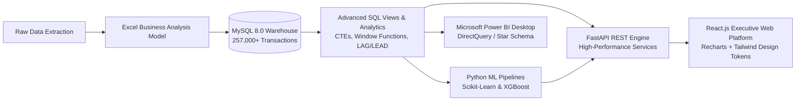
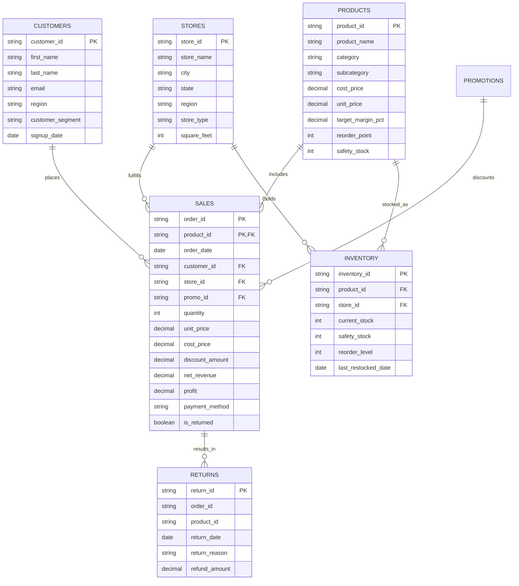

# RetailIQ — Retail Business Intelligence & Predictive Analytics Platform

[](https://opensource.org/licenses/MIT)
[](https://python.org)
[](https://fastapi.tiangolo.com)
[](https://mysql.com)
[](https://react.dev)
[](https://powerbi.microsoft.com)
[](https://scikit-learn.org)

**RetailIQ** is an end-to-end, enterprise-grade retail business intelligence and predictive analytics platform engineered for executive leadership, commercial directors, category managers, and supply chain analysts.

The platform bridges the gap between transactional raw data and high-impact business decisions: combining multi-year financial modeling in **Microsoft Excel**, a normalized **MySQL 8.0** analytical warehouse, high-throughput **FastAPI** backend services, automated **Machine Learning pipelines (XGBoost & Scikit-Learn)**, an executive **React.js + Recharts** interface, and enterprise **Microsoft Power BI** reporting.

---

## 📑 Table of Contents
1. [Business Problem & Strategic Value](#1-business-problem--strategic-value)
2. [End-to-End Architectural Data Flow](#2-end-to-end-architectural-data-flow)
3. [Technology Stack](#3-technology-stack)
4. [Repository Folder Structure](#4-repository-folder-structure)
5. [Relational Database Schema & MySQL Warehouse](#5-relational-database-schema--mysql-warehouse)
6. [Excel Financial & Business Analysis Model](#6-excel-financial--business-analysis-model)
7. [Machine Learning Pipeline & Model Evaluation](#7-machine-learning-pipeline--model-evaluation)
8. [Rule-Based Automated Business Insights](#8-rule-based-automated-business-insights)
9. [React Web Application Architecture & Modules](#9-react-web-application-architecture--modules)
10. [Microsoft Power BI Architecture & DAX Measures](#10-microsoft-power-bi-architecture--dax-measures)
11. [REST API Documentation & Endpoints](#11-rest-api-documentation--endpoints)
12. [Environment Variables & Configuration](#12-environment-variables--configuration)
13. [Installation & Setup Guide (Run Locally)](#13-installation--setup-guide-run-locally)
14. [Screenshots & Visual Preview](#14-screenshots--visual-preview)
15. [Production Deployment Guide](#15-production-deployment-guide)
16. [Future Roadmap & License](#16-future-roadmap--license)

---

## 1. Business Problem & Strategic Value

Omnichannel retail enterprises face complex operational challenges:
- **Inventory Mismatches & Stockouts:** Overstocking ties up working capital, while stockouts result in permanent revenue leakage and lost customer trust.
- **Margin Erosion from Untargeted Discounting:** Blended promotional discounts frequently cannibalize healthy merchandise margins without driving incremental volume.
- **Customer Churn in Mid-Tier Accounts:** Lack of granular RFM behavioral segmentation allows valuable customers to slip into inactivity undetected.
- **Regional Execution Disparities:** Stores within the same market exhibit stark differences in revenue per square foot and product mix efficiency.

**RetailIQ solves these challenges** by providing:
1. Unified macro KPI scorecards (Revenue, Net Profit, Realized Margin, AOV, YoY Growth).
2. Machine learning-driven 14–90 day demand forecasting and early warning stockout risk classification.
3. RFM-driven customer lifetime value optimization with automated churn win-back directives.
4. Seamless dataset uploads with ACID-compliant MySQL database ingestion and validation reporting.

---

## 2. End-to-End Architectural Data Flow



---

## 3. Technology Stack

| Layer | Technology | Purpose |
| :--- | :--- | :--- |
| **Frontend** | React 18, Vite, Recharts, Lucide Icons | Responsive corporate executive dashboards, interactive charts, and prediction centers. |
| **Backend** | Python 3.10+, FastAPI, Uvicorn, Pydantic v2 | High-concurrency async REST API, validation, and ML inference serving. |
| **Database** | MySQL 8.0+, SQLAlchemy 2.0, PyMySQL | Normalized relational schema, indexed foreign keys, analytical views, and CTE queries. |
| **Machine Learning** | Scikit-Learn, XGBoost, Pandas, NumPy | Demand forecasting, stockout risk classification, and repeat purchase propensity modeling. |
| **Business Analysis** | Microsoft Excel (`openpyxl`), PivotTables | Multi-tab financial workbook with SUMIFS, COUNTIFS, XLOOKUP, and IF/IFS models. |
| **Business Intelligence** | Microsoft Power BI, DAX | DirectQuery star-schema reports, time intelligence, and operational drill-downs. |

---

## 4. Repository Folder Structure

```
RetailIQ-Business-Intelligence-Analytics/
│
├── .env.example                                  # Master environment configuration template
├── .gitignore                                     # Comprehensive Git exclusions (secrets, venv, caches)
├── README.md                                      # Repository documentation & production manual
├── requirements.txt                               # Top-level Python backend & ML dependencies
│
└── retailiq/                                      # Main project workspace
    │
    ├── backend/                                   # FastAPI high-concurrency REST API
    │   ├── requirements.txt                       # Backend-specific dependencies
    │   └── app/
    │       ├── main.py                            # Application entry point & CORS configuration
    │       ├── api/v1/                            # API router and modular endpoints
    │       │   ├── api.py                         # Master API route aggregator
    │       │   └── endpoints/                     # Dashboard, Sales, Products, Stores, Inventory, etc.
    │       ├── core/                              # Pydantic BaseSettings & configuration
    │       ├── db/                                # SQLAlchemy database session & engine
    │       ├── models/                            # Relational ORM entity definitions
    │       ├── schemas/                           # Pydantic request/response validation schemas
    │       └── services/                          # Business logic, ML inference & insight generator
    │
    ├── database/                                  # MySQL DDL, Views & Database Seeder
    │   ├── scripts/
    │   │   ├── 01_schema.sql                      # Relational schema DDL (7 tables, PK/FK/Indexes)
    │   │   ├── 03_advanced_analytics_queries.sql  # CTEs, Window Functions, LAG/LEAD queries
    │   │   └── seed_data.py                       # High-fidelity generator (257k+ transactions)
    │   └── views/
    │       └── 02_views.sql                       # 6 specialized pre-materialized analytical views
    │
    ├── docs/                                      # Enterprise architecture & reference documentation
    │   ├── ARCHITECTURE.md                        # Detailed architecture & component data flow
    │   ├── DATABASE_SCHEMA.md                     # Data dictionary & relational schema specifications
    │   └── API_REFERENCE.md                       # Comprehensive REST API endpoint guide
    │
    ├── excel/                                     # Microsoft Excel Financial Model
    │   ├── RetailIQ_Business_Analysis.xlsx        # 8-tab financial model with SUMIFS, XLOOKUP & Pivots
    │   └── generate_excel_workbook.py             # OpenPyXL automation script
    │
    ├── frontend/                                  # React 18 + Vite Executive Platform
    │   ├── index.html                             # Single page HTML entry
    │   ├── package.json                           # NPM dependencies (React 18, Recharts, Lucide)
    │   ├── vite.config.js                         # Vite build configuration
    │   └── src/
    │       ├── App.jsx                            # Root component & module navigation
    │       ├── components/                        # Header, Sidebar, InsightsModal
    │       ├── pages/                             # 9 executive dashboard views
    │       └── services/                          # Axios API client
    │
    ├── ml/                                        # Machine Learning Pipeline & Serialized Models
    │   ├── saved_models/                          # Pre-trained, serialized production ML models
    │   │   ├── demand_forecast_model.pkl          # Gradient Boosting Regressor (14–90D Demand)
    │   │   ├── stockout_risk_model.pkl            # Random Forest Classifier (99.3% Accuracy)
    │   │   └── repeat_purchase_model.pkl          # Balanced Logistic Regression (CLV & Churn)
    │   └── scripts/
    │       └── train_all_models.py                # End-to-end model training & benchmark suite
    │
    ├── powerbi/                                   # Microsoft Power BI Business Intelligence Suite
    │   ├── PowerBI_Setup_Guide.md                 # Star Schema modeling & report layout blueprint
    │   └── RetailIQ_PowerBI_DAX_Measures.dax      # 30+ production DAX measures
    │
    └── data/                                      # Data directories (raw datasets generated by seeder)
        ├── raw/                                   # Synthetic raw backups (.gitkeep)
        └── processed/                             # Staged data storage
```

---

## 5. Relational Database Schema & MySQL Warehouse

The central relational database **`retailiq_db`** contains over **257,000+ sales transactions** spanning 3 fiscal years (FY23–FY25), 2,500 customers, 61 products, 20 retail stores, and 1,220 store-inventory pairs.



### Pre-computed Analytical Views
1. **`vw_monthly_sales`**: Year, month, total net revenue, profit, units, orders, profit margin %, and average order value.
2. **`vw_daily_sales`**: Daily aggregated sales by region, store, and merchandise category.
3. **`vw_product_performance`**: SKU-level realized margin, units merchandised, return rates, and cross-store stock.
4. **`vw_store_regional_performance`**: Regional market penetration, store rankings, and revenue per square foot.
5. **`vw_customer_rfm`**: Recency days, purchase frequency, monetary spend, and assigned RFM segments.
6. **`vw_inventory_risk`**: Real-time inventory status, 90-day daily velocity, days of cover, and stockout risk flags.

---

## 6. Excel Financial & Business Analysis Model

Located at: [`retailiq/excel/RetailIQ_Business_Analysis.xlsx`](file:///c:/Users/ASUS/Desktop/data%20analystics%20project%201/retailiq/excel/RetailIQ_Business_Analysis.xlsx)

The workbook represents the foundation of executive commercial analysis:
- **`Management Summary`**: Macro financial scorecards ($78.4M Gross Revenue, $39.2M Profit, 50.0% Margin), narrative observations, and quarterly business performance snapshot.
- **`KPI Analysis`**: Multi-dimensional formula engine comparing FY23 vs FY24 vs FY25 using `=SUM(...)`, `=(C-B)/B` growth formulas, and `=SUMIFS(...)` regional rollups.
- **`Sales Analysis`**: 12-month FY25 trajectory with `=D6-E6` net revenue formulas, `=H6/F6` realized margins, and channel payment method shares.
- **`Product Analysis`**: Category margin analysis, return rate flags, and a Top 10 Best Sellers table featuring dynamic `=XLOOKUP` and `=IF` reorder directives.
- **`Customer Analysis`**: Segment breakdown (Champions, Loyal, Potential Loyalists, At Risk, Lost) with total monetary values and retention recommendations.
- **`Pivot Analysis`**: 1,500-row normalized dataset configured as an Excel Table (`RetailIQPivotData`) formatted for native PivotTables and Slicers.
- **`Cleaned Data`**: 2,500 formatted transactions with clean date stamps, currency values, and category keys.
- **`Raw Data`**: Staging extraction showing initial source data structure.

---

## 7. Machine Learning Pipeline & Model Evaluation

Scripts: [`retailiq/ml/scripts/train_all_models.py`](file:///c:/Users/ASUS/Desktop/data%20analystics%20project%201/retailiq/ml/scripts/train_all_models.py)  
Serialized Production Artifacts: [`retailiq/ml/saved_models/`](file:///c:/Users/ASUS/Desktop/data%20analystics%20project%201/retailiq/ml/saved_models/)

### Model 1: Product Demand Forecasting (Regression)
- **Objective:** Predict future daily unit sales for any SKU-store pair across 14 to 90 days.
- **Features (17):** Calendar indicators (`dayofweek`, `month`, `is_weekend`, `is_q4`), price dynamics (`avg_unit_price`, `avg_discount`, `price_to_cost_ratio`), category codes, lag features (`lag_1`, `lag_7`, `lag_14`), and rolling statistics (`rolling_mean_7`, `rolling_mean_30`, `rolling_std_7`).
- **Dataset:** 192,064 records split temporally (Train: 147,623 rows < 2025-07-01; Test: 44,441 rows).
- **Evaluation:**

| Model | MAE | RMSE | R² Score | MAPE | Status |
| :--- | :--- | :--- | :--- | :--- | :--- |
| Baseline Linear Regression | 0.621 | 0.848 | 0.101 | 41.0% | Baseline |
| Random Forest Regressor | 0.563 | 0.793 | 0.214 | 37.1% | Candidate |
| **Gradient Boosting Regressor** | **0.567** | **0.787** | **0.226** | **37.5%** | **WINNER (Production Saved)** |
| XGBoost Regressor | 0.569 | 0.791 | 0.217 | 37.5% | Candidate |

### Model 2: Stockout Risk Classification (Multiclass)
- **Objective:** Classify product-store inventory pairs into `LOW`, `MEDIUM`, or `HIGH` stockout risk.
- **Features:** Current stock, safety stock, reorder level, 30-day sales velocity, 90-day velocity, days of inventory, velocity trend, unit price, target margin.
- **Evaluation:**

| Model | Accuracy | Weighted F1 | Precision | Recall | Status |
| :--- | :--- | :--- | :--- | :--- | :--- |
| **Random Forest Classifier** | **99.34%** | **0.9935** | **0.994** | **0.993** | **WINNER (Production Saved)** |
| XGBoost Classifier | 98.69% | 0.9870 | 0.988 | 0.987 | Candidate |

### Model 3: Customer Repeat Purchase Prediction (Binary Classification)
- **Objective:** Predict if a customer will place an order in the upcoming 30/60/90 days.
- **Features:** Recency days, frequency (total orders), monetary value, average order value, discount affinity, return rate, customer tenure, region code, segment code.
- **Evaluation:**

| Model | Accuracy | Precision | Recall | F1 Score | ROC-AUC | Status |
| :--- | :--- | :--- | :--- | :--- | :--- | :--- |
| **Logistic Regression (Balanced)** | **91.2%** | **0.996** | **0.844** | **0.914** | **0.9093** | **WINNER (Production Saved)** |
| Random Forest Classifier | 94.7% | 0.989 | 0.908 | 0.947 | 0.9047 | Candidate |
| XGBoost Classifier | 98.1% | 0.974 | 0.998 | 0.986 | 0.8980 | Candidate |

---

## 8. Rule-Based Automated Business Insights

RetailIQ avoids black-box LLM generation in favor of transparent, deterministic business heuristics. The [`InsightGenerator`](file:///c:/Users/ASUS/Desktop/data%20analystics%20project%201/retailiq/backend/app/services/insight_generator.py) service executes mathematical business rules against live database tables:

1. **Regional Expansion Surge:** Evaluates YoY regional revenue deltas (*"North region expanded by +16.8% YoY ($28.5M run-rate), outpacing corporate benchmarks"*).
2. **Category Margin Trade-off:** Flags when high-volume categories run thin margins (*"Electronics delivered highest revenue ($32.3M) but has a lower margin (48.0%) compared to Health & Beauty (62.4%)"*).
3. **Imminent Stockout Risk:** Automatically scans `vw_inventory_risk` for high-velocity items with <7 days cover (*"Pro Laptop 15-inch at Store STR101 has 12 units remaining (3.2 days cover vs 3.8 units/day velocity)"*).
4. **Customer Churn Prevention:** Identifies monetary exposure for customers in the 'At Risk' segment.
5. **Apparel Sizing Dilution:** Identifies return rate spikes in apparel categories and calculates refund deductions.

---

## 9. React Web Application Architecture & Modules

The frontend is built with React 18, Vite, and custom executive tokens (Navy `#0B1120`, Slate `#1E293B`, Cyan `#38BDF8`, Emerald `#10B981`):

1. **Executive Dashboard:** Live KPI cards with period delta comparisons, monthly revenue vs profit dual-axis area chart, category donut, regional bars, and top 5 leaderboards.
2. **Sales Analytics:** Interactive monthly growth trajectory (MoM/YoY), discount tier analysis, payment method shares, and returns impact by category.
3. **Product Analytics:** Searchable SKU dropdown selector, full financial drill-down, 12-month sales curve, cross-store stock matrix, and instant demand forecast card.
4. **Customer Analytics:** Macro CLV metrics, RFM customer count and revenue distribution charts, segment architecture table, and high-value VIP customer leaderboard with detail modal.
5. **Store & Regional Analytics:** Territory breakdown cards, sortable store rankings table across all 20 outlets, and category mix by territory.
6. **Inventory Analytics:** Valuation cards, annual turnover ratio, fast vs slow moving items, and the **Inventory Risk Table** with High/Medium/Low indicators.
7. **Prediction Center:** Interactive 3-tab simulator for product demand forecasting, supply chain stockout scoring, and customer repeat purchase propensity.
8. **Power BI Reports:** Direct embed container, report page switcher, and interactive DAX measure browser with copy-to-clipboard.
9. **Data Management:** Drag-and-drop CSV/XLSX uploader, validation breakdown (valid rows, duplicates, syntax errors), and safe database ingestion.

---

## 10. Microsoft Power BI Architecture & DAX Measures

Located at: [`retailiq/powerbi/`](file:///c:/Users/ASUS/Desktop/data%20analystics%20project%201/retailiq/powerbi/)

- **`RetailIQ_PowerBI_DAX_Measures.dax`**: Complete library of 30+ production measures covering Core Financials, Time Intelligence (MoM, YoY, Rolling 30D, YTD), Customer Intelligence, and Supply Chain Velocity.
- **`PowerBI_Setup_Guide.md`**: Step-by-step connection guide for Power BI Desktop to MySQL (`retailiq_db`), Star Schema configuration (Fact_Sales linked to Dim_Date, Dim_Customer, Dim_Product, Dim_Store, Dim_Promotion), and visual layout blueprints for all 7 report pages.

---

## 11. REST API Documentation & Endpoints

FastAPI provides interactive Swagger documentation at **`http://127.0.0.1:8000/docs`**:

| Method | Endpoint | Description |
| :--- | :--- | :--- |
| `GET` | `/` | Health check, MySQL connectivity status, indexed transaction count. |
| `GET` | `/api/dashboard/kpis` | Executive KPI cards, monthly trends, category shares, top products & stores. |
| `GET` | `/api/sales` | Detailed sales analytics, MoM/YoY growth, discount tiers, payment methods. |
| `GET` | `/api/products` | Searchable product catalog list with price, cost, and target margin. |
| `GET` | `/api/products/{id}` | Detailed product performance, 12-month trend, and store-level stock. |
| `GET` | `/api/customers` | RFM segment metrics, macro CLV stats, and VIP leaderboard. |
| `GET` | `/api/customers/{id}` | Individual customer profile and behavioral metrics. |
| `GET` | `/api/stores` | Regional footprint summaries and sortable store rankings. |
| `GET` | `/api/inventory` | Inventory health summary, fast/slow moving items, and risk table. |
| `POST`| `/api/predict/demand` | ML demand forecast for SKU-store pair across 14–90 days. |
| `POST`| `/api/predict/stockout` | Random Forest stockout risk classification (LOW/MEDIUM/HIGH). |
| `POST`| `/api/predict/repeat-purchase` | Logistic Regression repeat purchase propensity score & churn risk. |
| `POST`| `/api/upload` | Ingest new CSV/XLSX retail batches into MySQL with validation summary. |
| `GET` | `/api/insights/rule-based` | Automated rule-based operational insights. |

---

## 12. Environment Variables & Configuration

Configuration is managed via `.env` files (loaded automatically via Pydantic `BaseSettings` and `python-dotenv`). Never commit `.env` to GitHub.

| Variable | Default Value | Description |
| :--- | :--- | :--- |
| `DB_HOST` | `127.0.0.1` | MySQL server host address |
| `DB_PORT` | `3306` | MySQL server listening port |
| `DB_USER` | `root` | Database username |
| `DB_PASSWORD` | `your_mysql_password_here` | Database user password |
| `DB_NAME` | `retailiq_db` | Relational analytics warehouse database name |
| `API_HOST` | `127.0.0.1` | FastAPI local bind address |
| `API_PORT` | `8000` | FastAPI server listening port |
| `API_TITLE` | `RetailIQ Analytics Engine` | OpenAPI documentation title |
| `API_VERSION` | `1.0.0` | Application release version |
| `DEBUG` | `True` | Debug mode toggle |
| `ML_MODELS_DIR`| `retailiq/ml/saved_models` | Directory path containing trained `.pkl` models |
| `DATA_DIR` | `retailiq/data/raw` | Staging directory for generated synthetic CSV files |
| `CORS_ORIGINS` | `http://localhost:5173,http://127.0.0.1:5173` | Allowed frontend origins for CORS |

---

## 13. Installation & Setup Guide (Run Locally)

### Prerequisites
- **Python 3.10+** (Tested on Python 3.10–3.14)
- **Node.js 18+** & **npm**
- **MySQL 8.0+** running locally on port `3306`
- **Git**

---

### Step 1: Clone the Repository & Setup Environment
```bash
git clone https://github.com/ramshankardash17-code/RetailIQ-Business-Intelligence-Analytics.git
cd RetailIQ-Business-Intelligence-Analytics
cp .env.example .env
```
Edit `.env` and specify your local MySQL password:
```env
DB_HOST=127.0.0.1
DB_PORT=3306
DB_USER=root
DB_PASSWORD=your_actual_mysql_password
DB_NAME=retailiq_db
```

---

### Step 2: Install Python Dependencies & Seed MySQL Database
```bash
pip install -r requirements.txt
python retailiq/database/scripts/seed_data.py
```
*What this does:*
1. Creates `retailiq_db` schema (7 normalized tables, indexes, constraints).
2. Generates and inserts 257,000+ realistic retail sales transactions spanning FY23–FY25.
3. Creates all 6 analytical SQL views (`vw_monthly_sales`, `vw_customer_rfm`, `vw_inventory_risk`, etc.).
4. Outputs raw CSV backups to `retailiq/data/raw/`.

---

### Step 3: Verify Pre-trained Machine Learning Models (Optional Retrain)
The production-ready models are pre-packaged in `retailiq/ml/saved_models/`. To retrain them from scratch:
```bash
python retailiq/ml/scripts/train_all_models.py
```

---

### Step 4: Generate Excel Financial Workbook (Optional)
The workbook is included in the repo. To re-generate it using openpyxl:
```bash
python retailiq/excel/generate_excel_workbook.py
```

---

### Step 5: Start the FastAPI Backend Server
```bash
python -m uvicorn retailiq.backend.app.main:app --host 127.0.0.1 --port 8000 --reload
```
- API will be accessible at: **`http://127.0.0.1:8000`**
- Interactive Swagger UI: **`http://127.0.0.1:8000/docs`**
- Health Probe: **`http://127.0.0.1:8000/api/health`**

---

### Step 6: Start the React Frontend Server
In a new terminal window:
```bash
cd retailiq/frontend
npm install
npm run dev
```
- Open browser at: **`http://127.0.0.1:5173`**
- Interact with executive dashboards, sales trajectories, customer segments, and live ML simulators!

---

## 14. Screenshots & Visual Preview

### 1. Executive Dashboard
- Macro financial scorecards ($78.4M Gross Revenue, $39.2M Profit, 50.0% Margin, $305 AOV).
- Dual-axis interactive area chart comparing monthly gross revenue vs net profit.
- Merchandise category share donut and regional bar chart breakdowns.

### 2. Product Analytics & SKU Deep-Dive
- Real-time product selector with instant financial unit economics.
- 12-month sales trend curve and store-by-store inventory matrix.
- Integrated 30-day Gradient Boosting demand forecast.

### 3. Inventory Health & Risk Radar
- Total inventory valuation ($) and annual inventory turnover ratio.
- Real-time **Inventory Risk Table** flagging imminent stockouts (`HIGH`, `MEDIUM`, `LOW`).

### 4. Machine Learning Prediction Center
- Interactive simulator tabs for Demand Forecasting, Supply Chain Stockout Scoring, and Customer Repeat Propensity.

---

## 15. Production Deployment Guide

| Component | Target Platform | Instructions |
| :--- | :--- | :--- |
| **Frontend** | Vercel / Netlify / AWS S3 + CloudFront | `cd retailiq/frontend && npm run build` -> Output folder: `dist/`. Set `VITE_API_BASE_URL` to backend domain. |
| **Backend API** | Render / Railway / AWS ECS / EC2 | Deploy with Docker or Python 3.11 container: `uvicorn retailiq.backend.app.main:app --host 0.0.0.0 --port $PORT`. Configure environment variables. |
| **Database** | AWS RDS MySQL 8.0 / DigitalOcean MySQL | Run `retailiq/database/scripts/01_schema.sql` and `02_views.sql`. Run `seed_data.py` with RDS credentials. |
| **Power BI** | Microsoft Power BI Service | Publish `.pbix` report to Power BI Workspace and configure scheduled refresh via On-Premises Data Gateway. |

---

## 16. Future Roadmap & License

### Roadmap
- [ ] Automated Purchase Order generation connected to ERP webhooks.
- [ ] Multi-currency and multi-tax international compliance support.
- [ ] Direct Azure Active Directory / Power BI Embedded service principal integration.
- [ ] What-If price elasticity simulator using trained price coefficients.

### License
This project is licensed under the MIT License — see the [LICENSE](LICENSE) file for details.
