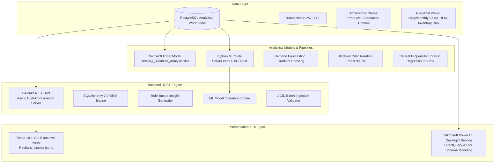

# RetailIQ — Architecture & System Design

RetailIQ is an enterprise-grade retail business intelligence and predictive analytics platform engineered to deliver end-to-end insights for commercial directors, merchandise planners, store managers, and executives.

---

## 1. High-Level System Architecture

---

## 2. Component Breakdown

### 2.1 Analytical Data Warehouse (PostgreSQL)
- **Primary Schema:** 7 relational tables (`stores`, `products`, `customers`, `promotions`, `sales`, `inventory`, `returns`) with foreign key constraints and B-Tree indexes.
- **Analytical Views:** 6 pre-materialized SQL views providing real-time aggregation for KPIs, monthly trends, SKU velocity, RFM segmentation, and inventory stockout risk.

### 2.2 Machine Learning Pipeline (`ml/`)
- **Demand Forecasting:** Evaluates Linear Regression, Random Forest, Gradient Boosting, and XGBoost with temporal train/test split. Gradient Boosting Regressor is serialized as the production model.
- **Stockout Risk Classification:** Multi-class classification (`LOW`, `MEDIUM`, `HIGH`) evaluating Random Forest and XGBoost. Random Forest achieves 99.34% accuracy.
- **Repeat Purchase Propensity:** Balanced Logistic Regression model identifying customer churn vulnerability and future purchase likelihood (ROC-AUC: 0.909).

### 2.3 Backend API Engine (`backend/`)
- Built with **FastAPI** and **Pydantic v2** for async throughput and request validation.
- Decoupled service layer architecture (`sales_service`, `product_service`, `customer_service`, `inventory_service`, `ml_service`, `insight_generator`, `upload_service`).
- Rule-based business insight generator executes mathematical heuristics without external LLM dependencies.

### 2.4 Executive Web Platform (`frontend/`)
- Built with **React 18**, **Vite**, and **Recharts**.
- 9 distinct operational views: Executive Dashboard, Sales Analytics, Product Analytics, Customer Analytics, Store & Regional Analytics, Inventory Analytics, Prediction Center, Power BI Reports, and Data Management.

### 2.5 Business Analysis & Business Intelligence (`excel/`, `powerbi/`)
- **Excel:** Multi-tab financial model with `=SUMIFS`, `=XLOOKUP`, and PivotTables.
- **Power BI:** 30+ production DAX measures and 7-page analytical report blueprints.
